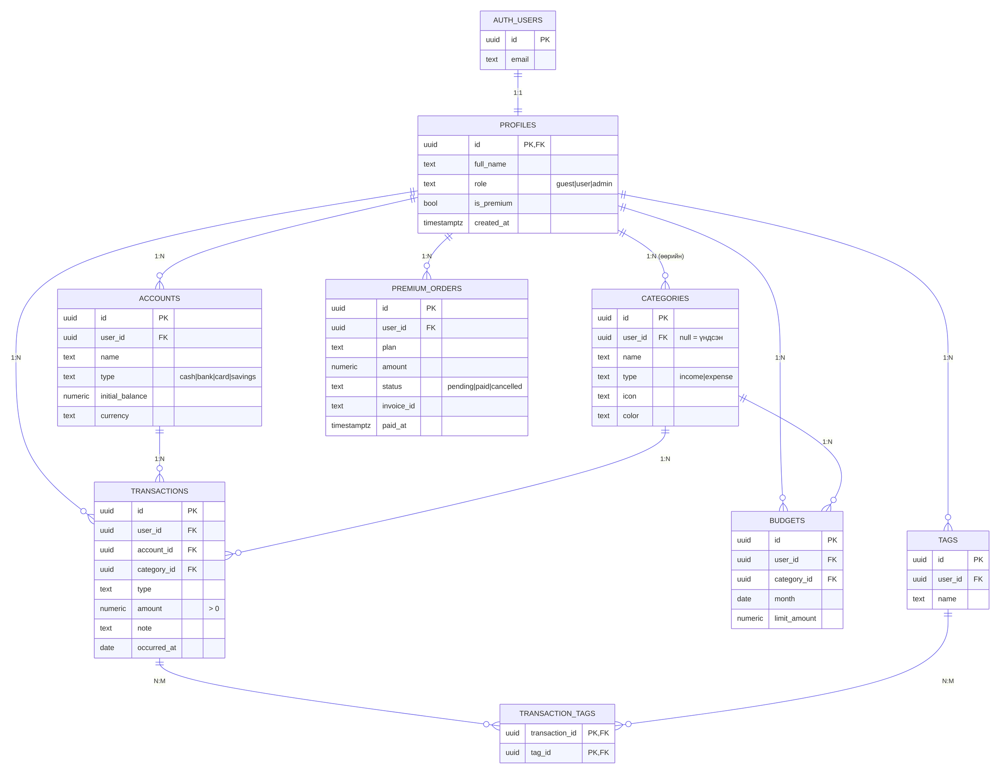
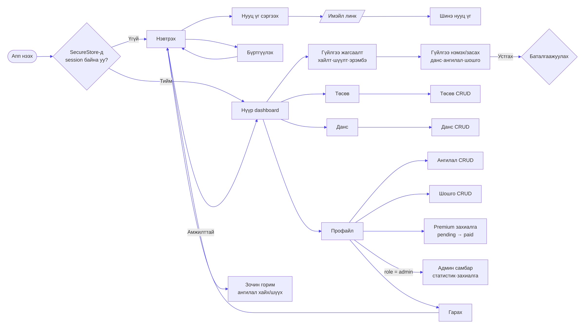
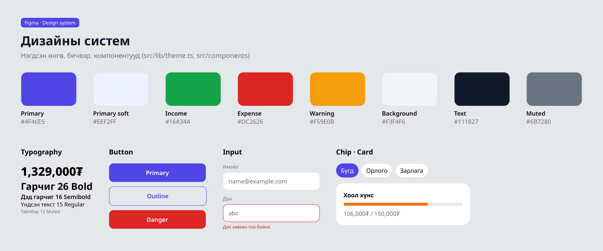
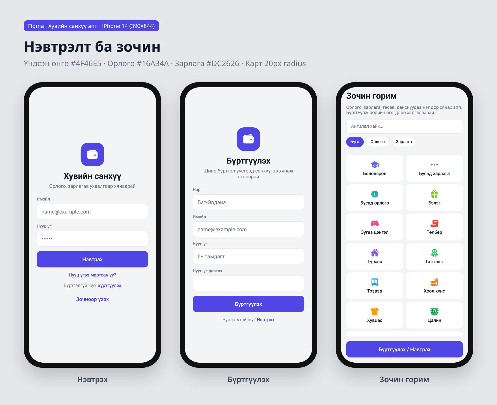
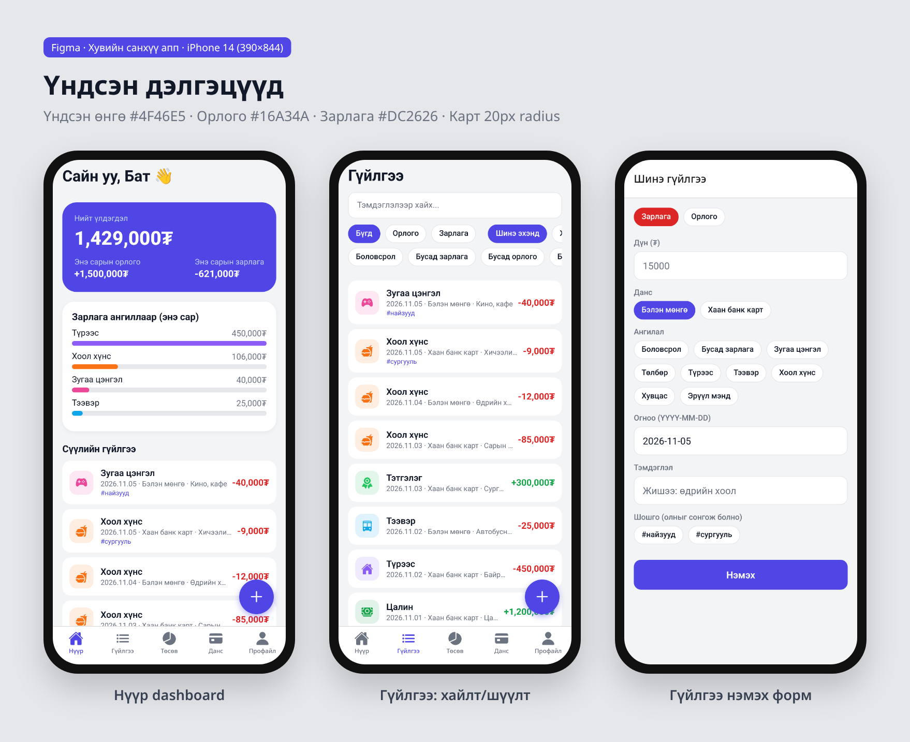
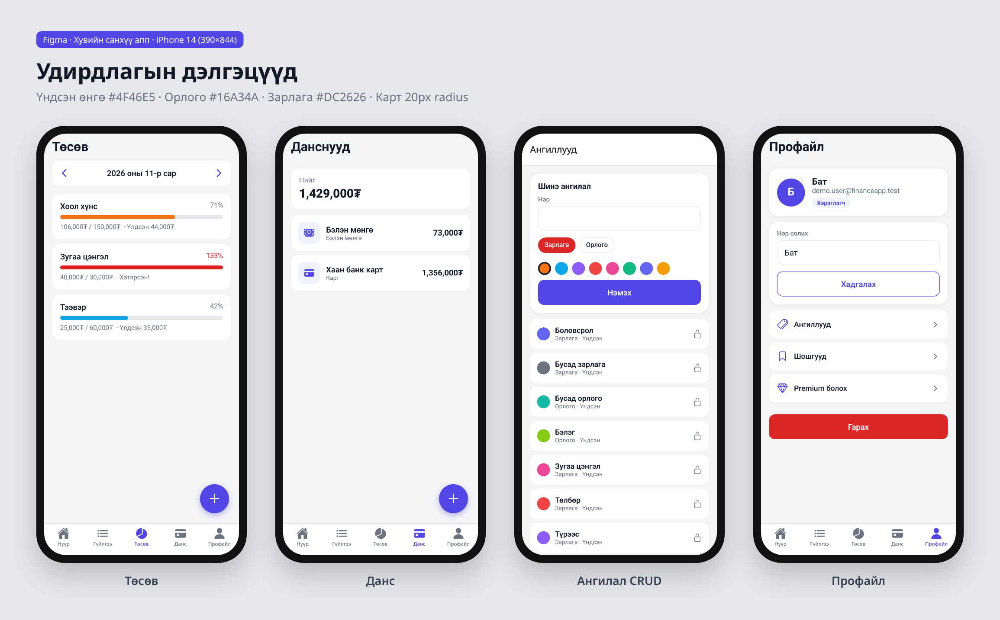
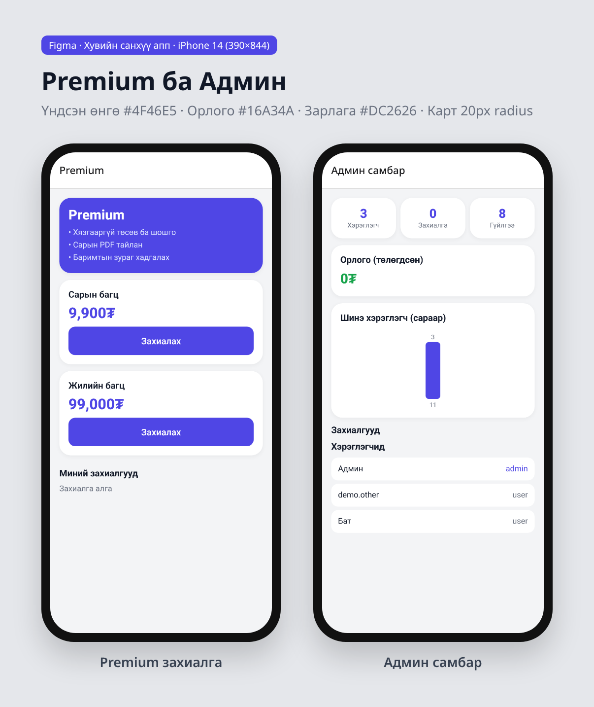

# Z Money

Өмнөх нэр нь «Миний мөнгө» байсан. Одоогийн хэрэглэгчид харагдах нэр нь «Z Money». Салбар, багцын нэр, scheme өөрчлөгдөөгүй.

Гараар бүртгэдэг хувийн санхүү. Гурван таб: Нүүр, Гүйлгээ, Төсөв. Нийт үлдэгдэл, энэ сарын цэвэр, төсвөөс үлдсэн нь гурван өөр тоо. Нийлбэр зөвхөн ижил валют дотор. MNT дээр ₮, бусад дээр валютын код. Ханш байхгүй.

Харагдах байдал нь хар `#000000`, карт `#121212`, цагаан үсэг, ногоон `#00BA7C`. Ногоон товч дээр хар үсэг. Энэ нь X Money аппын дэлгэц биш. Хэв маягийн эх: [9to5Mac](https://9to5mac.com/2026/07/27/x-money-apple-wallet/), [Bangkok Post](https://www.bangkokpost.com/life/tech/3294994/elon-musk-launches-x-money), [AP](https://apnews.com/article/elon-musk-x-money-cross-river-payments-0bb86f98e0747757992bc8f435f7014e). `money.x.com` 403 тул аппын дэлгэц баталгаажаагүй.

Ажиллуулах: `npm install`, `.env` дотор зөвхөн нийтийн `EXPO_PUBLIC_SUPABASE_URL` ба `EXPO_PUBLIC_SUPABASE_ANON_KEY`, дараа нь `npx expo start -c`. `scripts/rls-test.mjs` амьд төсөл `rahymsygjwytwludoucq` руу бичихгүй. Шинэ хүснэгт, migration байхгүй. ERD: `docs/diagrams/erd.mmd`, `supabase/schema.sql`-той тулгасан. Дизайн ба FigJam нь үзэл баримтлал, аппын бодит дэлгэцийн зураг биш. Вэб дээр нэвтэрч, хичээлийн жишээ мөрүүдийг хадгалсан. Түр `QA_DEMO` мөрүүдийг үүсгэж, уншиж, засаж, устгасан. Хуучин 2 гүйлгээ ба `[ДЕМО]` 3 зарлага, 3 төсөв үлдсэн.

`https://finance-app-supabase.vercel.app` нь өмнөх байршуулалт. Энэ салбарын одоогийн Z Money биш. Байнгийн нийтийн хаяг хараахан байхгүй. Vercel нэвтрэлт хүлээгдэж байна.

Кодын асуулт, `d734767` дээрх мөр:

1. `src/lib/validation.ts` 48-р мөр `todayISO` нь `localTodayISO`-г дуудна. `toISOString` UTC тул өглөөний өдөр зөрж болно.
2. `supabase/schema.sql` 196–202-р мөр `transactions owner all` нь `user_id` болон дансны эзнийг хамт шалгана.
3. `src/services/tags.ts` 23–27-р мөр `setTransactionTags` хуучин холбоог устгаад шинийг нэмнэ. Энэ нь `transaction_tags` N:M.

# Хувийн санхүүгийн апп (Finance App · Supabase)

**SWM231 Мобайл програмчлал — Бие даалтын төсөл · Хамгаалалт-1**

Өмнөх вэб хаяг `https://finance-app-supabase.vercel.app` энэ салбарын Z Money биш. Нууц үгийг README-д бичихгүй. Анги нэг бүр өөрийн бүртгэлээр орно. Эзний бүртгэлийг тараахгүй.

React Native (Expo) + TypeScript + Expo Router + Supabase ашигласан, хувийн орлого, зарлага, данс, төсөв, шошгоо нэг дор хянах full-stack мобайл апп.

## 🎯 Шийдэх асуудал

Оюутан, залуучууд мөнгөө хаана зарцуулж байгаагаа мэддэггүй, сарын төгсгөлд мөнгө дутдаг. Банкны апп нь зөвхөн тухайн банкны гүйлгээг харуулдаг бөгөөд бэлэн мөнгө, олон данс, ангиллын төсвийг нэгтгэдэггүй. Энэ апп нь:

- бүх данс (бэлэн мөнгө, карт, хадгаламж)-ыг нэг дор нэгтгэнэ,
- гүйлгээг ангилал, шошгоор (N:M) бүртгэж, хайх/шүүх боломж олгоно,
- ангилал бүрт сарын төсөв тогтоож, хэтэрвэл анхааруулна,
- өгөгдлийг Supabase-д хадгалж, RLS-ээр хэрэглэгч бүрийн өгөгдлийг тусгаарлана.

## 👥 Хэрэглэгчийн төрлүүд

| Role | Эрх |
|---|---|
| **Зочин (guest)** | Бүртгэлгүйгээр апп-ын тухай болон үндсэн ангиллуудыг хайж, шүүж үзнэ (anon RLS) |
| **Хэрэглэгч (user)** | Данс, гүйлгээ, төсөв, ангилал, шошгоо CRUD хийнэ, Premium захиалга үүсгэнэ |
| **Админ (admin)** | Апп доторх админ самбараас хэрэглэгч, захиалга, орлогын статистикийг график/жагсаалтаар харж, захиалгын төлөв өөрчилнө |

## ✨ Боломжууд (Хамгаалалт-1)

- ✅ **Supabase Auth** — бүртгүүлэх, нэвтрэх, гарах, нууц үг сэргээх (имэйл линк + PKCE)
- ✅ **SecureStore** — session-ийг iOS Keychain / Android Keystore-д (хэсэглэж) хадгална
- ✅ **Хамгаалалттай навигаци** — `Stack.Protected` (guest / user / admin)
- ✅ **8 хүснэгт**, PK/FK, 1:N, N:M (`transaction_tags`), CHECK, UNIQUE
- ✅ **RLS бүх хүснэгтэд** + `is_admin()` SECURITY DEFINER функц
- ✅ **CRUD**: данс, гүйлгээ, төсөв, ангилал, шошго — validation + устгахын өмнө баталгаажуулалт
- ✅ **Хайлт, шүүлт, эрэмбэ** (тэмдэглэл, төрөл, ангилал, огноо/дүн), **infinite scroll**, **pull-to-refresh**
- ✅ **Dashboard** — нийт үлдэгдэл, сарын орлого/зарлага, ангиллын график
- ✅ **Админ самбар** — статистик, сараар бүртгэлийн график, захиалгын жагсаалт
- ✅ **UI төлөвүүд** — ачаалж буй, хоосон, алдаа, интернэт тасарсан (NetInfo)
- ✅ **Premium захиалга** (`premium_orders`, pending → paid trigger) — Хамгаалалт-2-т QPay/Stripe webhook холбогдоно

## 🧱 Технологи

| Хэсэг | Технологи |
|---|---|
| Frontend | React Native 0.88, Expo SDK 58, TypeScript, Expo Router (Stack + Tabs) |
| Backend | Supabase (Auth, PostgreSQL, RLS, View, Trigger) |
| Аюулгүй байдал | expo-secure-store, RLS, `.env` (зөвхөн anon key) |
| Бусад | @react-native-community/netinfo, @expo/vector-icons |

## 🗂️ Кодын бүтэц

```
src/
├── app/                      # Expo Router — файл = дэлгэц
│   ├── _layout.tsx           # AuthProvider + Stack.Protected (guest/user/admin)
│   ├── index.tsx             # session-оос хамаарч redirect
│   ├── (auth)/               # login, register, forgot-password
│   ├── (tabs)/               # home, transactions, budgets. Профайл ба данс stack дэлгэц
│   ├── transaction/[id].tsx  # гүйлгээ нэмэх/засах/устгах (id = 'new' → нэмэх)
│   ├── account/[id].tsx      # данс форм
│   ├── budget/[id].tsx       # төсөв форм
│   ├── categories.tsx, tags.tsx, premium.tsx, admin.tsx, guest.tsx, reset-password.tsx
├── components/               # Button, Input, Card, Chip, Fab, StateViews, OfflineBanner, ...
├── context/AuthContext.tsx   # session, profile, role, signIn/signUp/signOut/reset
├── hooks/useAsync.ts         # useFocusData — focus бүрд өгөгдөл ачаална
├── lib/                      # supabase client, secureStorage, validation, theme, format
├── services/                 # Supabase query-ууд (accounts, transactions, budgets, tags, ...)
└── types/database.ts         # хүснэгтийн TypeScript төрлүүд
supabase/
├── schema.sql                # хүснэгт, view, функц, trigger, RLS policy
├── seed.sql                  # 13 үндсэн ангилал
└── demo-data.sql             # demo хэрэглэгчийн туршилтын өгөгдөл
scripts/rls-test.mjs          # бодит Supabase дээр Auth + CRUD + RLS тест (36 шалгалт)
docs/                         # ERD, user flow, дизайн, дэлгэцийн зургууд
```

## 🗄️ Өгөгдлийн сан (ERD)



| Хүснэгт | Тайлбар | Холбоо |
|---|---|---|
| `profiles` | auth.users-ийн өргөтгөл, `role` (guest/user/admin), `is_premium` | auth.users 1:1 |
| `accounts` | Данс: бэлэн мөнгө, банк, карт, хадгаламж | profiles 1:N |
| `categories` | Ангилал (`user_id = null` → системийн үндсэн) | profiles 1:N |
| `transactions` | Орлого/зарлага, дүн > 0 | accounts 1:N, categories 1:N |
| `budgets` | Ангиллын сарын хязгаар, UNIQUE(user, category, month) | categories 1:N |
| `tags` | Хэрэглэгчийн шошго | profiles 1:N |
| `transaction_tags` | Гүйлгээ ↔ шошго, composite PK | **N:M** |
| `premium_orders` | Premium захиалга (pending/paid/cancelled) | profiles 1:N |
| `account_balances` (view) | Үлдэгдэл = эхний үлдэгдэл + орлого − зарлага, `security_invoker` | — |

### RLS (Row Level Security)

- Бүх 8 хүснэгтэд `enable row level security`.
- Хэрэглэгч зөвхөн `user_id = auth.uid()` мөрөө харж/өөрчилнө.
- `transactions` insert/update хийхэд **данс нь өөрийнх эсэхийг** `exists(...)`-ээр шалгана.
- `transaction_tags` — гүйлгээ ба шошго хоёулаа өөрийнх байх ёстой.
- `categories` — үндсэн ангиллыг зочин (anon) ч уншина, зөвхөн өөрийнхөө ангиллыг засна.
- `premium_orders` — хэрэглэгч зөвхөн `pending` үүсгэнэ, төлөвийг зөвхөн админ/webhook өөрчилнө.
- `is_admin()` — `SECURITY DEFINER` тул profiles-ийн RLS-ийг тойрч уншина → policy дотор recursion үүсэхгүй.
- `protect_profile_fields` trigger — хэрэглэгч өөрийгөө admin/premium болгож чадахгүй.

## 🔁 Хэрэглэгчийн урсгал



## 🎨 Дизайн ба ERD

Засах боломжтой. Хоёулаа үзэл баримтлал. Аппын бодит дэлгэцийн зураг биш. ERD-г амьд сангаас биш, `supabase/schema.sql`-оос баталгаажуулсан. 8 хүснэгт. `account_balances` нь view, 9 дэх хүснэгт биш. `categories.user_id` хоосон бол нийтийн ангилал. `transaction_tags` нь хос түлхүүр, `user_id` багангүй. `budgets.month` нь `date`. `premium_orders` схемд бий, төлбөрийн урсгал биш.

- [Figma дизайн](https://www.figma.com/design/BNT3uFJnOSpv7TdKDsNn6E)
- [FigJam ERD](https://www.figma.com/board/qMLQgmvIpDX0IEIOGsaYRB)

## 🎨 Хуучин дотоод зураг

| | |
|---|---|
|  |  |
|  |  |



## 📱 Дэлгэцийн зургууд

| Дэлгэц | Тайлбар |
|---|---|
| `01-login` | Нэвтрэх — имэйл/нууц үг validation, Монгол алдааны мессеж, «Зочноор үзэх» |
| `02-register` | Бүртгүүлэх — нэр, имэйл, нууц үг давталт шалгана |
| `03-guest` | Зочин — үндсэн ангиллыг хайх/шүүх (нэвтрэлтгүй, anon RLS) |
| `04-home` | Нүүр — нийт үлдэгдэл, энэ сарын цэвэр, төсвөөс үлдсэн, сүүлийн гүйлгээ. Гурван тоо тусдаа |
| `05-transactions` | Гүйлгээ — хайлт (debounce), төрөл/ангилал шүүлт, эрэмбэ, infinite scroll, pull-to-refresh |
| `06-transaction-form` | Гүйлгээ нэмэх/засах — данс, ангилал, огноо, тэмдэглэл, олон шошго (N:M) |
| `07-budgets` | Төсөв — сар солих, зарцуулалтын явц. Зурвас ногоон. Хэтрэлтийг «Хэтэрсэн» текст харуулна |
| `08-accounts` | Данс — view-ээс тооцсон үлдэгдэл |
| `09-categories` | Ангилал — үндсэн нь 🔒, өөрийнх CRUD |
| `10-profile` | Профайл — role badge, нэр засах, цэс, гарах (баталгаажуулалт) |
| `11-premium` | Premium багц захиалах — pending төлөв |
| `12-admin` | Админ — хэрэглэгч/захиалга/гүйлгээний тоо, орлого, график |

Зургууд: [`docs/screenshots/`](docs/screenshots)

## 🚀 Суулгах, ажиллуулах

```bash
git clone https://github.com/giikhnaranbattulga7-ship-i/finance-app-supabase.git
cd finance-app-supabase
npm install
cp .env.example .env    # EXPO_PUBLIC_SUPABASE_URL, EXPO_PUBLIC_SUPABASE_ANON_KEY бөглөнө
npx expo start -c      # Expo Go-оор QR уншуулна. Энэ алхам энд ажиллаагүй
```

Expo Go, оюутны машин дээр:

1. Утсан дээр Expo Go суулгана. Компьютер ба утас нэг сүлжээнд байна.
2. `cursor/minii-mungu-design-69fa` салбарыг татна. `npm install`.
3. `.env` файлд зөвхөн нийтийн Supabase URL ба anon/publishable түлхүүр. Файл commit хийхгүй.
4. `npx expo start -c`. Android дээр Expo Go-оор QR уншина. iOS дээр камераар уншина.
5. Өөрийн имэйлээр бүртгүүлнэ. Эзний бүртгэлээр орохгүй.
6. Данс, нэг зарлага, нэг төсөв нэмээд устгахын өмнөх асуултыг харна.

Android эмулятор: Android Studio → Device Manager → виртуал төхөөрөмж асаагаад `npx expo start -c` дээр `a` дарна. Энэ орчинд SDK байхгүй тул эмулятор асаагаагүй.

### Supabase тохиргоо (шинэ төсөл дээр)

1. Supabase → SQL Editor дээр `supabase/schema.sql`, дараа нь `supabase/seed.sql`-ийг ажиллуулна.
2. (Сонголт) Demo хэрэглэгч бүртгүүлээд `supabase/demo-data.sql`-ийг ажиллуулна.
3. Админ болгох: `update profiles set role = 'admin' where id = (select id from auth.users where email = '...');`
4. Authentication → URL Configuration → Redirect URLs-д `financeapp://**` болон `exp://**` нэмнэ (нууц үг сэргээх линк).
5. Demo-д хурдан бүртгүүлэхийн тулд Authentication → Providers → Email → **Confirm email**-ийг унтрааж болно.

### Тест

```bash
npm run typecheck      # TypeScript
npm run build:web      # expo export -p web
TEST_A_EMAIL=... TEST_B_EMAIL=... TEST_ADMIN_EMAIL=... TEST_PASSWORD=... npm run test:rls
```

## 🔐 Аюулгүй байдал

- `.env` нь `.gitignore`-д орсон; апп-д **зөвхөн anon (нийтийн) түлхүүр** `EXPO_PUBLIC_` хувьсагчаар орно.
- `service_role` түлхүүр апп-ын кодонд **хэзээ ч байхгүй** — апп-ыг задалж уншиж болох тул.
- Хамгаалалт нь клиент дээр биш, **өгөгдлийн сангийн RLS** дээр хийгдэнэ.

## 🗺️ Хамгаалалт-2 төлөвлөгөө

- QPay sandbox нэхэмжлэх (Supabase Edge Function) + webhook → `premium_orders.status = 'paid'`
- Expo Push Notification (захиалгын төлөв өөрчлөгдөхөд)
- Баримтын зураг: камер/цомог → шахах → Supabase Storage
- EAS Build → APK / бодит утсанд суулгах
